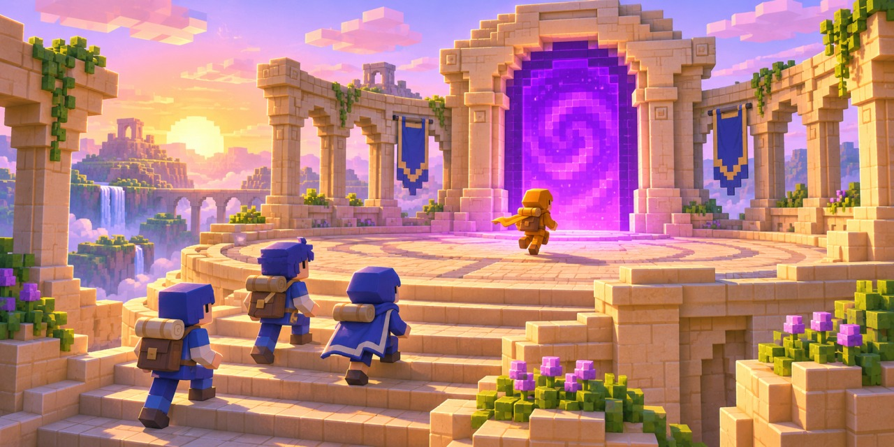
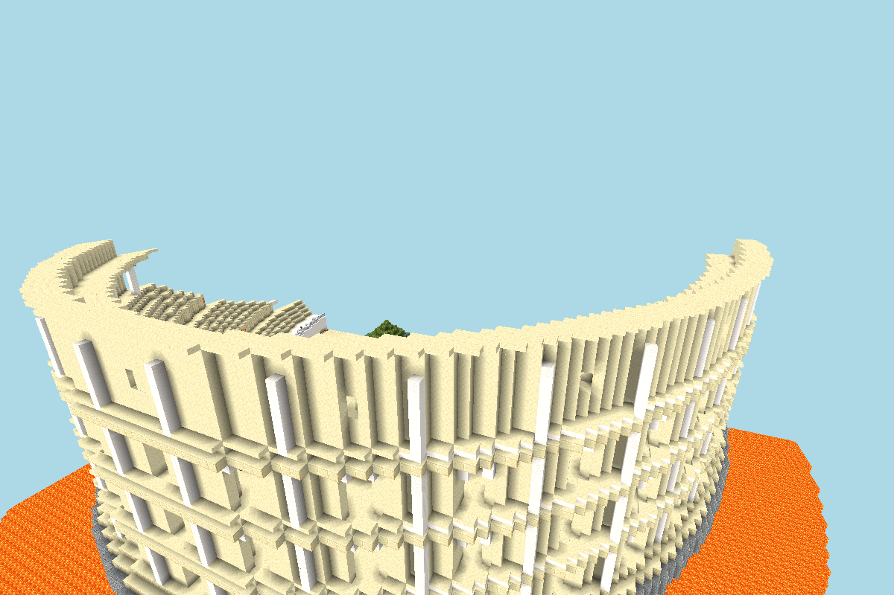
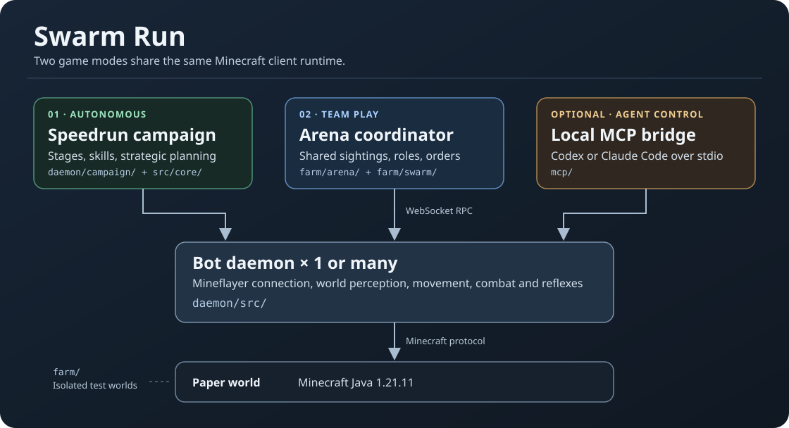

# Swarm Run

**PvP swarms and autonomous speedrunning for Minecraft Java 1.21.11.**



[Local setup and play](docs/local-play.md) · [По-русски](docs/README.ru.md) · [Architecture](docs/media/architecture.svg)

Swarm Run is an experimental bot lab with two game modes on the same Mineflayer runtime. You can join a local Paper arena with a regular Minecraft client, run a speedrun campaign, or control one bot through MCP from Codex or Claude Code. The autonomous modes run without an AI agent or model API key.

> Unofficial Minecraft project. Not approved by or associated with Mojang or Microsoft. [Minecraft Usage Guidelines](https://www.minecraft.net/en-us/usage-guidelines)

## PvP swarm

Bots start with a loot phase, then share sightings and supplies, pick targets, and adjust roles as the fight changes. The arena coordinator assigns actions such as flanking, guarding and retreat. Each bot owns its movement and executes attacks through its own client.

- **What works.** Weapon-aware retreats and melee pressure, shield reactions, elytra pursuit, and aerial spear and mace attacks. Wind charges can lift, redirect or eject opponents. A late swap from wind charge to mace was fully blocked in a controlled Paper test.
- **Where it struggles.** A target can cross the rim and recover. Cover, strafing, packet timing and access to a second throwing position can break a wind chain. Wind-to-spear and wind-to-mace follow-ups have succeeded in controlled scenarios. Their timing in a crowded fight still varies.
- **How decisions are tested.** Unit and replay tests check local rules. Paper matches measure whether contacts, blocks, landings and ejections actually happen. An ejection requires the opponent to finish outside the arena.



*The generated Colosseum, captured from the development viewer. The cover above is an illustration.*

## Autonomous speedrun

The campaign moves through milestones for survival, iron, a lava-cast portal, Nether resources, stronghold routing and the dragon. The strategic graph compares prerequisites, costs and risks. It checks results against fresh observations. Tactical and emergency behavior can take over to handle immediate danger.

| Stage | Current development status |
| --- | --- |
| Overworld → Nether | Reached in test series on selected seeds. Early food, equipment and portal access still vary by world. |
| Nether → Stronghold → End | Current bottleneck. Bastion entry, bartering, blaze rods and fortress routing have individual scenarios. Consecutive success in the full route remains open. |
| Dragon fight | Repeated wins from prepared End entries. These trials start with a known loadout and measure the fight. |
| Fresh world → Dragon | Experimental campaign. A repeatable full clear is an open milestone. |

The default knowledge mode is `rsg`. A fair run uses observations available to the bot, without operator permissions or administrative commands. The test farm can stage scenarios, select seeds and run controlled comparisons. See the [speedrun notes](SPEEDRUN.md) and [PvP mechanics notes](PVP-RESEARCH.md).

## How it fits together

[](docs/media/architecture.svg)

| Component | Role |
| --- | --- |
| [Bot daemon](daemon/src/) | Owns the Mineflayer session, tick clock, navigation, inventory, combat and reflexes. Exposes local WebSocket RPC. |
| [Campaign](daemon/campaign/) and [strategy core](daemon/src/core/) | Select and run speedrun stages and skills. |
| [Arena](farm/arena/) and [swarm planner](farm/swarm/) | Build arenas, run matches, share observations and assign tasks across bot processes. |
| [MCP bridge](mcp/) | Runs over stdio and forwards `mc_*` tools to a bot daemon. |
| [Test farm](farm/) | Runs isolated Paper worlds and repeatable scenarios. |

## Run and test

Start with [Local setup and play](docs/local-play.md). It covers the Paper template, a bot-vs-human arena, the non-operator campaign, clean shutdown and MCP setup for both clients. The managed farm instructions target Windows and use Java 21 and Node.js.

From the repository root after installing the locked dependencies:

```powershell
npm.cmd run typecheck
npm.cmd test
node dist/mcp/smoke.js
```

Project constraints for coding agents are in [AGENTS.md](AGENTS.md). The bridge exposes a single bot. Use the arena coordinator to manage a whole match.

[MIT license](LICENSE).
