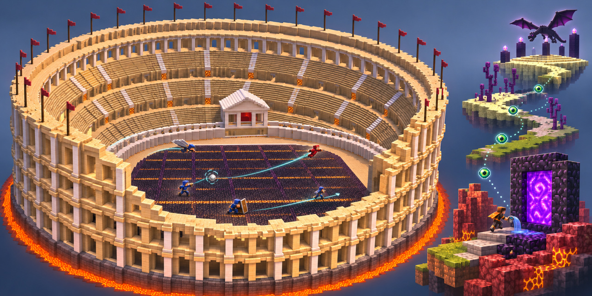
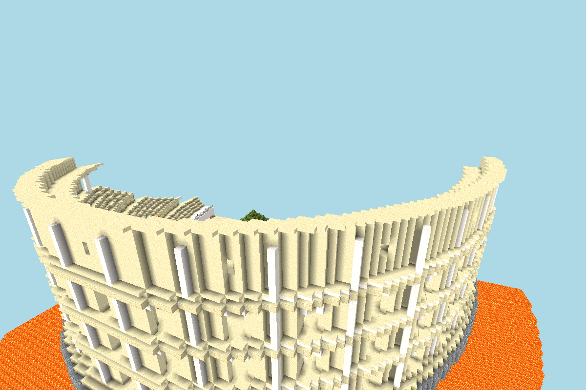
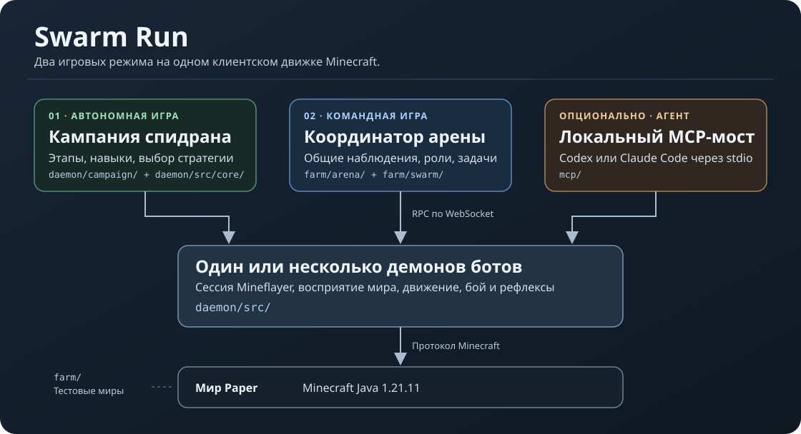

# Swarm Run

**Роевой PvP и автономный спидран для Minecraft Java 1.21.11.**

[English](../README.md) · [Роевой PvP](#что-умеет-рой) · [Архитектура](#архитектура) · [Как попробовать](#как-попробовать)

На локальной арене Paper можно зайти с обычного клиента Minecraft и сыграть против команды ботов. В кампании один бот самостоятельно проходит этапы спидрана. Из Codex и Claude Code можно управлять отдельным ботом через локальный MCP. Оба автономных режима работают без агента и ключа к API модели.

> Неофициальный проект Minecraft. Без одобрения Mojang или Microsoft. [Правила использования Minecraft](https://www.minecraft.net/en-us/usage-guidelines)

## Что умеет рой

Один бот давит спереди, второй перекрывает выход, третий заходит на элитрах со стороны центра. Когда противник взлетает от заряда ветра, следующий боец рассчитывает продолжение по новой траектории. Он может добавить толчок к краю или уступить окно союзнику с копьём или булавой.

*Колизей построен генератором проекта и снят в игровом просмотрщике. Обложка выше показывает постановочную сцену на основе этой арены.*

### Как команда принимает решения

Координатор сводит свежие наблюдения на общей доске. Он сопоставляет движение и экипировку целей с позициями, здоровьем и запасами своих бойцов, учитывает время подхода. Здоровье противника оценивается по подтверждённым попаданиям, видимому лечению и регенерации. Скрытое значение здоровья игрока не участвует в решениях. Пока игрока не видно, его последнее положение становится менее полезным для плана. [Доска команды](../daemon/src/swarm/board.ts) · [Планировщик роя](../daemon/src/swarm/plan-pvp.ts)

- **Лут и перегруппировка.** Боты расходятся за снаряжением и тайниками, передают друг другу лишнее оружие, броню и ракеты. Безоружный боец может выйти из контакта с хорошо экипированным противником и перевооружиться. Вооружённые союзники могут держать давление, пока раненые восстанавливаются. [Снабжение](../farm/swarm/swarm-driver/team.ts) · [Отход и восстановление](../daemon/src/swarm/plan-flee.ts)
- **Строй под ситуацию.** Рой может выбрать общую цель, раздать сектора для окружения, прикрыть раненых кольцом щитов или рассредоточиться против взрывов. Строители могут поставить заграждение с упреждением на пути убегающего игрока. Ложный отход может втянуть наступающего в засаду. Эти приёмы конкурируют за бойцов. Смена цели посреди контакта имеет свою цену. [Оценка строя](../daemon/src/swarm/doctrine.ts) · [Командные приёмы](../daemon/src/swarm/plan-doctrines.ts) · [Назначение бойцов](../daemon/src/swarm/plan-assign.ts)
- **Исполнение на клиенте.** Каждый бот сам идёт, экипируется, целится и наносит удар. Планировщик боя сравнивает ожидаемый урон, время подхода, восстановление атаки, состояние щита и риск ответного удара. Топор может отключить щит, меч держит давление, а копьё позволяет колоть с дистанции или наносить урон разогнанным выпадом с учётом относительной скорости. Если окно контакта или безопасной посадки исчезло, бот может прервать заход. [План атаки](../daemon/src/pvp/kill-planner.ts) · [Модель урона](../daemon/src/pvp/damage-model.ts)

### Как рой просчитывает цепочку ветра

1. **Восстанавливает движение.** Бот берёт видимые позиции с отметками игровых тиков. Он отличает движение по земле от прыжка и полёта на элитрах, оценивает ходьбу, спринт и стрейф, когда хватает наблюдений, и пересчитывает прогноз после видимого толчка. Собственная скорость бросающего тоже входит в стартовую скорость заряда. [Прогноз движения](../daemon/src/combat/enemy-wind.ts) · [Физика запуска](../daemon/src/combat/team-wind.ts)
2. **Ищет первое столкновение.** Базовая скорость заряда ветра — 1,5 блока за тик. В полёте на него не действуют гравитация и торможение. Бот проверяет траекторию и разброс по формам блоков и движущимся хитбоксам, сравнивает прямое попадание с порывом от поверхности. Порыв задевает цели на расстоянии до 2,4 блока. Взрыв у пола поднимает цель, а порыв со стороны центра может добавить скорости наружу. В расчёт входят место взрыва, укрытие, видимая экипировка и неопределённость по уровню взрывоустойчивости. [Параметры заряда](../daemon/src/combat/team-wind.ts) · [Столкновения и импульс](../daemon/src/combat/enemy-wind.ts)
3. **Сравнивает исходы на геометрии арены.** Бот по тикам проигрывает полёт и посадку с новым броском и без него. Он оценивает, поднимет ли порыв цель для следующего броска, приблизит ли её к эллиптической границе Колизея, вынесет ли наружу или создаст опасное падение. Можно перехватить и игрока, который сам взлетел ради удара булавой. Урон падения зависит от последнего порыва, точки посадки и защиты, в том числе «Невесомости». [Выбор броска](../daemon/src/combat/wind-out.ts) · [Прогноз полёта и посадки](../daemon/src/combat/enemy-wind.ts)
4. **Согласует очередь и повторно проверяет выпуск.** Наземные бойцы могут искать более пологий угол со стороны центра. Летящие — следующее окно перехвата. По командному каналу боты согласуют конкурирующие броски и отмечают, состоялся ли первый выпуск. Следующий расчёт может опираться на видимый заряд в полёте или на изменение скорости после подтверждённого порыва. Перед броском клиент заново проверяет траекторию, время и риск задеть союзников. Если обстановка изменилась, выпуск отменяется. [Координация ветра](../farm/swarm/swarm-driver/wind.ts) · [Проверки выпуска](../daemon/src/combat/enemy-wind-execute.ts)

### Что рой делает с найденным окном

| Тактика | Что рассчитывает бот |
| --- | --- |
| **Штурм на элитрах** | Моделирует поворот, наклон и тягу ракеты по тикам. Проверяет просвет в рельефе и ищет траекторию с контактом копьём и возможностью сесть. [Физика элитр](../daemon/src/elytra/physics.ts) · [Воздушный заход](../daemon/src/combat/wing-orbit.ts) |
| **Ветер → копьё или булава** | Если цель по прогнозу вернётся на арену, летящий боец оценивает перехват копьём. Координатор может отправить другого бота к точке падения. Тот подбрасывает себя зарядом ветра и подбирает момент нисходящего удара булавой. [Перехват копьём](../daemon/src/combat/wing-orbit.ts) · [Добивание булавой](../daemon/src/combat/pearl-ambush.ts) |
| **Подброс союзника** | Парный навык просчитывает порыв от пола и прыжок напарника на одной шкале тиков. Он проверяет, где смогут приземлиться оба. Для копья можно сравнить такой разгон с обычным заходом. [Парный навык ветра](../daemon/src/combat/team-wind.ts) · [Разгон копья](../daemon/src/combat/spear-wind.ts) |
| **Перехват по жемчугу** | Ведёт видимый жемчуг с учётом гравитации, сопротивления и столкновений. Для точки телепортации берёт положение жемчуга в начале тика удара. Ближайший боец может прибежать заранее, поставить паутину там, где это возможно, или подготовить засаду с булавой и самоподбросом. [Траектория жемчуга](../daemon/src/combat/pearl-watch.ts) · [Выбор реакции](../daemon/src/combat/pearl-intercept.ts) |
| **Защита от поздней смены на булаву** | Читает спуск и будущую точку контакта, пока противник ещё держит заряд ветра. Бот может начать поднимать щит заранее, довернуть его к атакующему или уйти от расчётной точки падения. [Защита от булавы](../daemon/src/pvp/turn-mace.ts) |

Ферма отдельно испытывает и другие связки. Среди них отключение щита топором перед ударами мечников, лечебное зелье по союзникам с проверкой зоны всплеска и вода в расчётной точке падения союзника. Для них есть отдельные сценарии и проверки безопасности. [Стендовые комбинации](../farm/swarm/swarm-driver/)

### Что подтвердил Paper

- В контролируемых прогонах были чистые выносы ветром, в том числе перехват у края после самоподброса цели. В другом прогоне противник пересёк границу всем хитбоксом, вернулся внутрь и погиб от падения. Такой исход учитываем как смерть от падения.
- Сервер подтвердил попадания копьём во время штурма на элитрах и два полных блока удара булавой, когда атакующий сменил заряд и ударил в одном тике. В изолированных сценариях оба подхвата копьём после ветра дали попадание и безопасную посадку. Оба подхвата булавой убили уязвимую цель, а помощник безопасно приземлился.
- Вынос движущейся цели из центра пока нестабилен. Стрейф и укрытие могут сорвать бросок, а помощник — опоздать к следующему окну. Тесты на записанных состояниях проверяют отдельные решения, прогоны на Paper измеряют фактические попадания, урон и конечную посадку или падение. [Разбор механик PvP](../PVP-RESEARCH.md) · [Телеметрия Paper](../farm/swarm/combo-probe/)

## Автономный спидран

Кампания ведёт бота от выживания и добычи железа через отливку портала, ресурсы Ада и поиск крепости к дракону. Стратегический граф сравнивает условия, цену и риск действий и проверяет их результат по новым наблюдениям. Тактика и аварийные рефлексы могут временно прервать план.

| Участок | Текущее состояние |
| --- | --- |
| Верхний мир → Ад | Есть успешные серии на отобранных сидах. Еда, экипировка и доступ к порталу всё ещё сильно зависят от мира. |
| Ад → крепость → Энд | Основное узкое место. Вход в бастион, бартер, добыча стержней и поиск крепости испытываются по отдельности. Стабильная связка в полном маршруте остаётся открытой. |
| Бой с драконом | Есть повторные победы из подготовленных входов в Энд. Эти прогоны измеряют сам бой с заданным инвентарём. |
| Новый мир → дракон | Экспериментальный режим. Повторяемое полное прохождение пока остаётся целью. |

По умолчанию включён режим знаний `rsg`. В честном прогоне бот опирается на доступные наблюдения и играет без прав оператора. На ферме можно подготовить начальные условия и повторять отдельные этапы. [Заметки по спидрану](../SPEEDRUN.md)

## Архитектура

| Компонент | За что отвечает |
| --- | --- |
| [Демон бота](../daemon/src/) | Держит сессию Mineflayer, игровые часы, навигацию, инвентарь, бой и рефлексы. Принимает команды через локальный WebSocket RPC. |
| [Кампания](../daemon/campaign/) и [стратегическое ядро](../daemon/src/core/) | Выбирают и исполняют этапы и навыки спидрана. |
| [Арена](../farm/arena/) и [рой](../farm/swarm/) | Строят поле, ведут матч, сводят наблюдения и назначают задачи между ботами. |
| [MCP-мост](../mcp/) | Принимает вызовы `mc_*` по stdio и передаёт их одному демону. |
| [Тестовая ферма](../farm/) | Поднимает изолированные миры Paper для повторяемых сценариев. |

## Как попробовать

1. Установи Node.js и JDK 21, скачай Paper 1.21.11 build 132 и подготовь `server-twin`. [Подготовка сервера](local-play.md#2-prepare-paper-once)
2. Для боя начни с четырёх ботов и зайди за красных на `127.0.0.1:25601`. [Арена](local-play.md#3a-play-the-arena)
3. Для спидрана запусти Paper, демон и кампанию в отдельных терминалах. [Кампания](local-play.md#3b-run-or-watch-the-campaign)
4. Для управления через Codex или Claude Code подключи `swarm-run-minecraft`. Начни с `mc_status`, `mc_connect` и `mc_observe`. [MCP](local-play.md#4-control-one-bot-with-codex-or-claude-code)

[Лицензия MIT](../LICENSE).
